# Gestion des identités avec Microsoft Entra ID : utilisateurs, groupe, SSPR et MFA

Atelier pratique réalisé dans un **tenant Microsoft Entra ID de laboratoire**. Il couvre le provisionnement d'un nouveau service (DevSupport) : création des comptes, création d'un groupe de sécurité, activation de la réinitialisation de mot de passe en libre-service (SSPR) et activation de l'authentification multifacteur (MFA).

> **Nature du projet** : exercice de formation réalisé dans le cadre d'un projet Coursera sur la sécurité Azure. Ce dépôt documente un exercice de laboratoire. Ce n'est ni une solution de production ni une certification Microsoft.

---

## Sommaire

1. [Présentation](#1-présentation)
2. [Contexte et objectifs](#2-contexte-et-objectifs)
3. [Périmètre fonctionnel](#3-périmètre-fonctionnel)
4. [Architecture et fonctionnement](#4-architecture-et-fonctionnement)
5. [Technologies et services Microsoft utilisés](#5-technologies-et-services-microsoft-utilisés)
6. [Prérequis](#6-prérequis)
7. [Organisation des fichiers](#7-organisation-des-fichiers)
8. [Étapes de réalisation (portail)](#8-étapes-de-réalisation-portail)
9. [Équivalent en ligne de commande (optionnel, non testé)](#9-équivalent-en-ligne-de-commande-optionnel-non-testé)
10. [Vérification et tests](#10-vérification-et-tests)
11. [Résultats et captures](#11-résultats-et-captures)
12. [Sécurité et confidentialité](#12-sécurité-et-confidentialité)
13. [Limites et améliorations possibles](#13-limites-et-améliorations-possibles)
14. [Références officielles Microsoft](#14-références-officielles-microsoft)

---

## 1. Présentation

Toutes les opérations ont été réalisées **manuellement dans le portail Azure** (blade Microsoft Entra ID), avec un compte administrateur général du tenant de laboratoire, puis avec un compte utilisateur standard pour les vérifications côté utilisateur.

Aucun script n'a été utilisé dans le projet original.

## 2. Contexte et objectifs

**Scénario** : une organisation crée un nouveau service, *DevSupport*, qui accueille trois employés : John, Dave et Jeff.

| # | Objectif |
|---|---|
| 1 | Créer les comptes Entra ID des trois employés |
| 2 | Créer un groupe `DevSupport` et y ajouter les trois comptes |
| 3 | Activer la réinitialisation de mot de passe en libre-service (SSPR) pour le groupe `DevSupport`, afin de réduire les appels au support |
| 4 | Tester la SSPR avec un compte non administrateur |
| 5 | Activer et vérifier la MFA pour John, Dave et Jeff |

## 3. Périmètre fonctionnel

**Inclus** (réalisé et documenté par captures) :

- Création d'utilisateurs membres (cloud uniquement).
- Création d'un groupe de sécurité à appartenance attribuée (*Assigned*) et ajout de membres.
- Activation de la SSPR limitée à un groupe (*Selected*).
- Enregistrement d'une méthode Microsoft Authenticator (TOTP) par un utilisateur.
- Changement de mot de passe par l'utilisateur depuis *My Account > Security info*.
- Activation de la MFA par utilisateur (*per-user MFA*) : statut `Enabled` ou `Enforced`.

**Non inclus** (non réalisé dans ce projet) : accès conditionnel, attribution de rôles (RBAC), inscriptions d'applications, identités managées, attribution de licences, analyse des journaux de connexion et d'audit, automatisation par Microsoft Graph.

## 4. Architecture et fonctionnement

```
Tenant Microsoft Entra ID (licence Entra ID P1)
│
├── Utilisateurs (membres, département = DevSupport)
│   ├── john@<TENANT_DOMAIN>
│   ├── dave@<TENANT_DOMAIN>
│   └── jeff@<TENANT_DOMAIN>
│
├── Groupe de sécurité « DevSupport » (Assigned, source Cloud)
│   └── Membres : john, dave, jeff
│
├── Password reset > Properties
│   └── SSPR activée : Selected → DevSupport
│
└── Per-user MFA
    ├── john : Enforced
    ├── dave : Enabled
    └── jeff : Enabled
```

Fonctionnement :

1. L'appartenance au groupe `DevSupport` détermine quels utilisateurs bénéficient de la SSPR.
2. Lors de sa connexion, l'utilisateur est invité à enregistrer une méthode de vérification (ici, l'application Authenticator en TOTP).
3. La MFA par utilisateur impose ensuite un second facteur lors des connexions.

## 5. Technologies et services Microsoft utilisés

| Élément | Usage dans le projet |
|---|---|
| Microsoft Entra ID (licence P1) | Annuaire, utilisateurs, groupes |
| Portail Azure, blade Microsoft Entra ID | Toutes les opérations d'administration |
| Self-Service Password Reset (SSPR) | Activation pour un groupe ciblé |
| Microsoft Entra multifactor authentication | MFA par utilisateur (méthode héritée) |
| Microsoft Authenticator | Enregistrement d'un code TOTP |
| My Account (`myaccount.microsoft.com`) | Gestion des informations de sécurité côté utilisateur |

## 6. Prérequis

- Un **tenant Microsoft Entra ID de test** dont vous êtes administrateur. N'utilisez jamais un tenant de production pour reproduire cet atelier.
- Une licence **Microsoft Entra ID P1 ou P2**, nécessaire pour limiter la SSPR à un groupe ; un essai gratuit convient.
- Un compte disposant du rôle **Administrateur général**, ou de rôles plus restreints comme *User Administrator* ou *Authentication Policy Administrator*.
- Un smartphone équipé de **Microsoft Authenticator**, ou d'une autre application TOTP.
- Une fenêtre de navigation privée, pour se connecter en tant qu'utilisateur de test.

Variables utilisées dans ce document (valeurs **fictives**, à remplacer par celles de votre environnement) :

| Variable | Exemple fictif |
|---|---|
| `<TENANT_DOMAIN>` | `contoso.onmicrosoft.com` |
| `<TENANT_ID>` | `00000000-0000-0000-0000-000000000000` |
| `<ADMIN_UPN>` | `admin@contoso.onmicrosoft.com` |

## 7. Organisation des fichiers

```
entra-id-identity-management/
├── README.md
├── docs/
│   └── screenshots/      # captures anonymisées, nommées par étape
└── .gitignore
```

## 8. Étapes de réalisation (portail)

> Les libellés correspondent à l'interface anglaise du portail Azure au moment de la réalisation, en octobre 2026. Ils peuvent évoluer.

### Tâche 1 : créer les comptes utilisateurs

1. **Microsoft Entra ID > Users > All users > New user > Create new user**.
2. Onglet **Basics** :
   - *User principal name* : `john` @ `<TENANT_DOMAIN>`
   - *Display name* : `John`
   - *Password* : **Auto-generate password**. Notez le mot de passe temporaire de manière sécurisée, jamais dans le dépôt.
   - *Account enabled* : coché
3. Onglet **Properties** : *First name*, *Last name*, *User type* = `Member`, *Department* = `DevSupport`.
4. **Review + create > Create**.
5. Répétez l'opération pour `dave` et `jeff`.

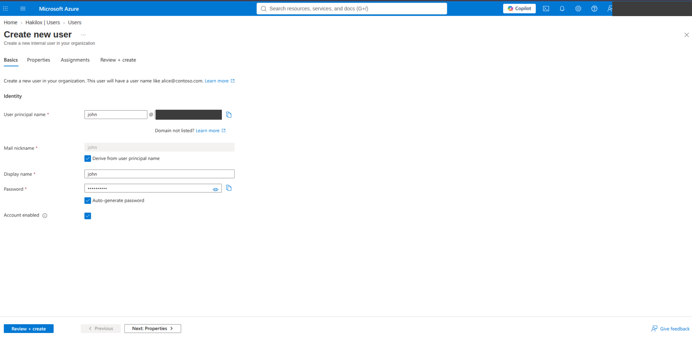

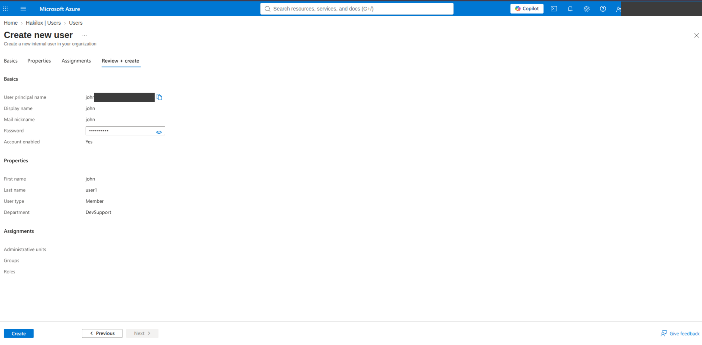

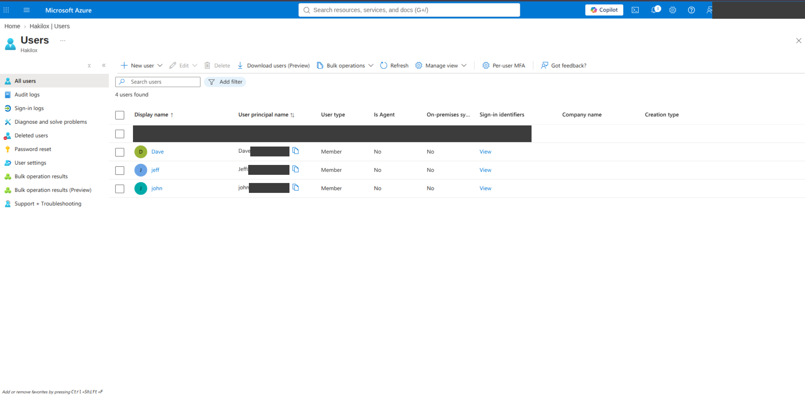

### Tâche 2 : créer le groupe DevSupport et ajouter les membres

1. **Microsoft Entra ID > Groups > All groups > New group**.
2. Paramètres :
   - *Group type* : `Security`
   - *Group name* : `DevSupport`
   - *Microsoft Entra roles can be assigned to the group* : `No`
   - *Membership type* : `Assigned`
3. **Create**.
4. Ouvrez le groupe, puis **Members > Add members**, sélectionnez `john`, `dave` et `jeff`, puis **Select**.

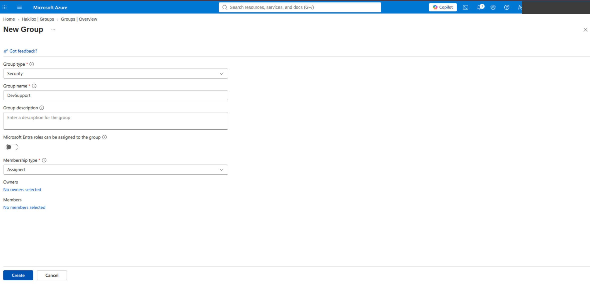

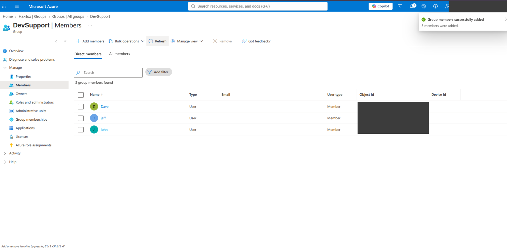

### Tâche 3 : activer la SSPR pour DevSupport

1. **Microsoft Entra ID > Password reset > Properties**.
2. *Self service password reset enabled* : **Selected**.
3. *Select group* : `DevSupport`.
4. **Save**.

> Remarque affichée par le portail : ces paramètres s'appliquent aux utilisateurs finaux. Les administrateurs sont toujours éligibles à la SSPR et doivent utiliser deux méthodes.

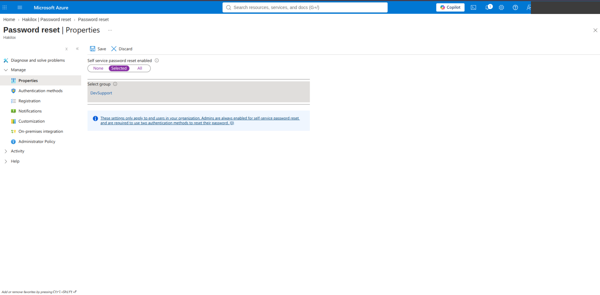

### Tâche 4 : tester côté utilisateur

1. Dans une fenêtre privée, connectez-vous en tant que `john@<TENANT_DOMAIN>` avec le mot de passe temporaire.
2. Lorsque le portail le demande, enregistrez l'application **Authenticator** en scannant le QR code. **Ne capturez jamais ce QR code** : il contient la clé secrète TOTP.
3. Allez dans **My Account > Security info** et vérifiez la présence de la méthode *Authenticator app (TOTP)*.
4. Changez le mot de passe depuis **Password > Change**.

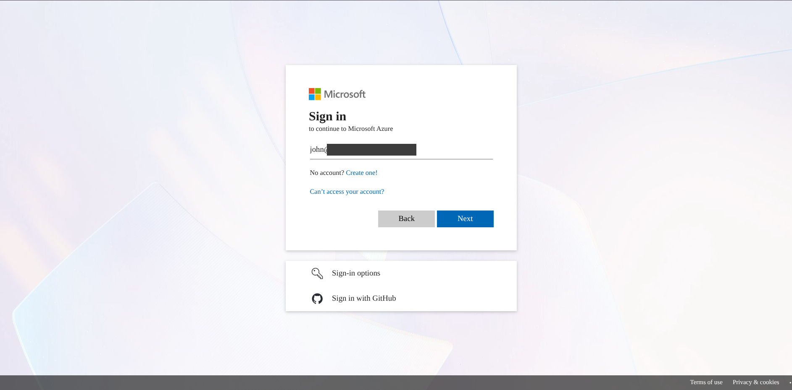

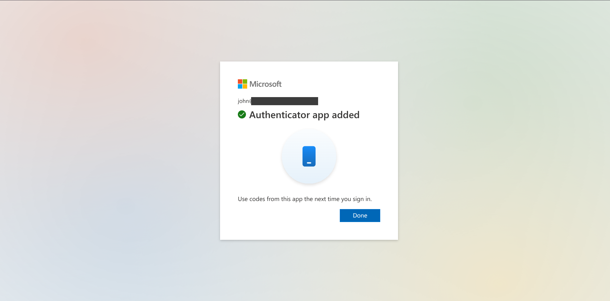

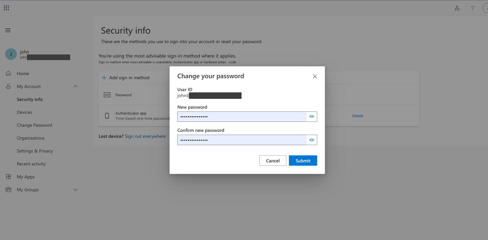

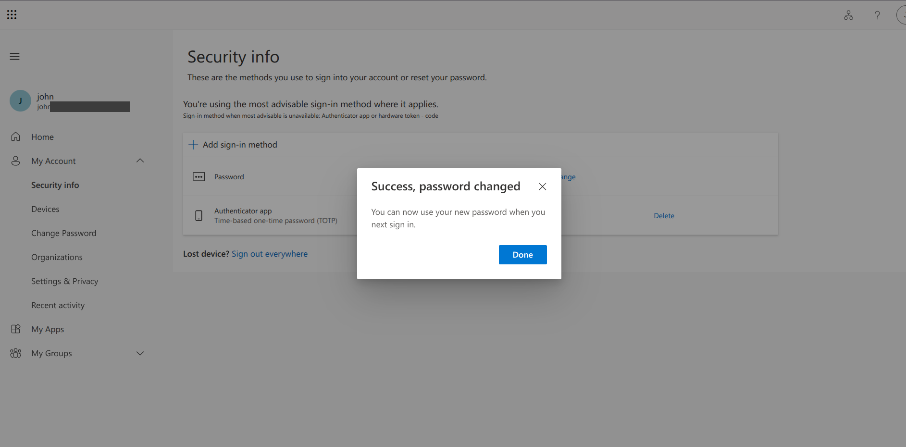

### Tâche 5 : activer la MFA par utilisateur

1. **Microsoft Entra ID > Security > Multifactor authentication > Additional cloud-based multifactor authentication settings**, page *Per-user multifactor authentication*.
2. Sélectionnez `dave` et `jeff`, puis **Enable MFA**.
3. Sélectionnez `john`, puis **Enforce MFA**.

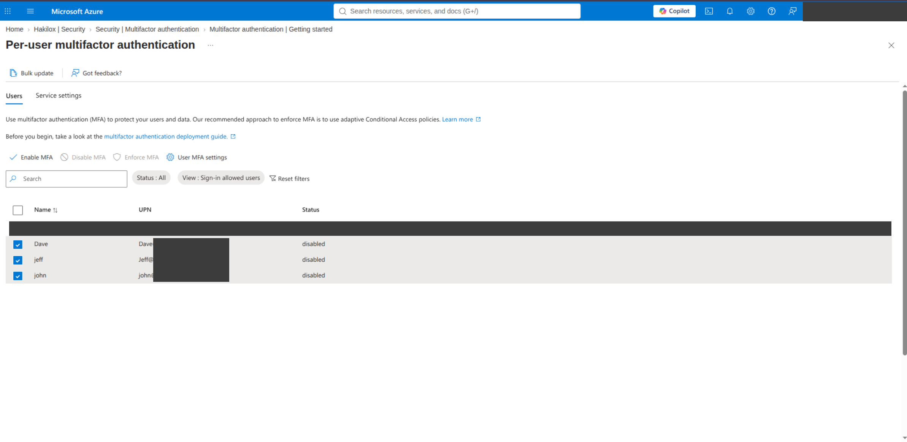

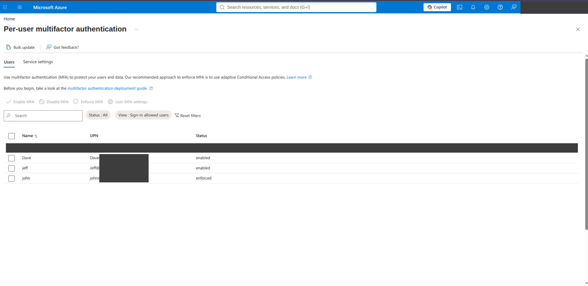

## 9. Équivalent en ligne de commande (optionnel, non testé)

> ⚠️ **Ces commandes n'ont pas été exécutées dans le projet original**, qui a été réalisé entièrement dans le portail. Elles sont fournies à titre indicatif pour reproduire les tâches 1 et 2 avec le module **Microsoft Graph PowerShell**. Vérifiez-les dans un tenant de test avant tout usage.

**Prérequis** : PowerShell 7 ou ultérieur, module `Microsoft.Graph` (`Install-Module Microsoft.Graph -Scope CurrentUser`), compte autorisé à consentir aux permissions demandées.

```powershell
# Connexion avec les permissions minimales nécessaires aux tâches 1 et 2
Connect-MgGraph -Scopes "User.ReadWrite.All", "Group.ReadWrite.All"

$tenantDomain = "<TENANT_DOMAIN>"   # ex. fictif : contoso.onmicrosoft.com

# Tâche 1 : création des utilisateurs (mot de passe temporaire saisi, jamais écrit dans le script)
$users = @("john", "dave", "jeff")
foreach ($u in $users) {
    $tempPassword = Read-Host -Prompt "Mot de passe temporaire pour $u"
    New-MgUser -DisplayName $u `
               -UserPrincipalName "$u@$tenantDomain" `
               -MailNickname $u `
               -Department "DevSupport" `
               -AccountEnabled `
               -PasswordProfile @{ Password = $tempPassword; ForceChangePasswordNextSignIn = $true }
}

# Tâche 2 : création du groupe de sécurité et ajout des membres
$group = New-MgGroup -DisplayName "DevSupport" -MailEnabled:$false -MailNickname "DevSupport" -SecurityEnabled
foreach ($u in $users) {
    $user = Get-MgUser -UserId "$u@$tenantDomain"
    New-MgGroupMember -GroupId $group.Id -DirectoryObjectId $user.Id
}

# Vérification
Get-MgGroupMember -GroupId $group.Id | ForEach-Object { (Get-MgUser -UserId $_.Id).UserPrincipalName }
```

Les tâches 3 (SSPR) et 5 (MFA par utilisateur) n'ont pas d'équivalent documenté dans ce projet. Elles restent réalisées dans le portail.

## 10. Vérification et tests

| Vérification | Résultat observé dans le projet | Preuve |
|---|---|---|
| Les 3 comptes existent | 4 utilisateurs listés (admin + 3) | capture 03 |
| Le groupe DevSupport contient 3 membres | notification « 3 members were added », 3 membres listés | capture 05 |
| La SSPR cible DevSupport | groupe `DevSupport` sélectionné dans *Password reset > Properties* | capture 06 |
| Un utilisateur enregistre une méthode | « Authenticator app added » pour john | capture 08 |
| Un utilisateur gère son mot de passe | « Success, password changed » pour john, depuis *Security info* | captures 09–10 |
| Statut MFA par utilisateur | dave `enabled`, jeff `enabled`, john `enforced` | capture 12 |

**Tests non documentés** (à réaliser pour compléter l'atelier) :

- Flux SSPR complet via **« Forgot my password »** sur la page de connexion, ou `https://passwordreset.microsoftonline.com`. Le test documenté ci-dessus est un *changement* de mot de passe par un utilisateur authentifié, pas une *réinitialisation*.
- Connexion de dave ou de jeff après activation de la MFA, pour vérifier la demande de second facteur.
- Consultation des **journaux de connexion** (*Sign-in logs*) et d'**audit** (*Audit logs*) pour tracer ces événements.

## 11. Résultats et captures

Les captures se trouvent dans [`docs/screenshots/`](docs/screenshots/). Elles ont été **anonymisées** : domaine du tenant, identifiants d'objets et identité de l'administrateur sont masqués.

| Fichier | Contenu |
|---|---|
| [01-create-user-form.png](docs/screenshots/01-create-user-form.png) | Formulaire de création d'utilisateur |
| [02-create-user-review.png](docs/screenshots/02-create-user-review.png) | Récapitulatif avant création (département DevSupport) |
| [03-all-users.png](docs/screenshots/03-all-users.png) | Liste des utilisateurs après création |
| [04-new-group.png](docs/screenshots/04-new-group.png) | Paramètres du groupe DevSupport |
| [05-group-members.png](docs/screenshots/05-group-members.png) | Membres du groupe après ajout |
| [06-sspr-selected-group.png](docs/screenshots/06-sspr-selected-group.png) | SSPR activée pour DevSupport |
| [07-sign-in-user.png](docs/screenshots/07-sign-in-user.png) | Connexion en tant qu'utilisateur de test |
| [08-authenticator-added.png](docs/screenshots/08-authenticator-added.png) | Méthode Authenticator enregistrée |
| [09-change-password.png](docs/screenshots/09-change-password.png) / [10-password-changed.png](docs/screenshots/10-password-changed.png) | Changement de mot de passe utilisateur |
| [11-per-user-mfa-before.png](docs/screenshots/11-per-user-mfa-before.png) / [12-per-user-mfa-after.png](docs/screenshots/12-per-user-mfa-after.png) | Statuts MFA avant et après |

## 12. Sécurité et confidentialité

- Le dépôt ne contient **aucun secret** : ni mot de passe, ni clé, ni jeton, ni identifiant de tenant réel.
- Les noms de domaine et identifiants affichés dans ce document sont **fictifs**.
- La capture du QR code d'enregistrement Authenticator a été **volontairement exclue** : un QR code TOTP contient la clé secrète de génération des codes.
- Les comptes de test du laboratoire doivent être désactivés ou supprimés une fois l'atelier terminé.

## 13. Limites et améliorations possibles

**Limites connues**

- Réalisation entièrement manuelle (portail) : pas d'automatisation ni d'infrastructure as code.
- La MFA est activée par la méthode **per-user MFA**, que Microsoft présente comme héritée. Le portail lui-même recommande l'**accès conditionnel**. Il affichait aussi une alerte invitant à migrer les anciennes stratégies MFA et SSPR vers la stratégie unifiée *Authentication methods*.
- Le test SSPR documenté est un changement de mot de passe, pas une réinitialisation via « Forgot my password ».
- Aucune vérification documentée de l'invite MFA après activation pour dave et jeff.
- Le compte administrateur affiche un statut per-user MFA `disabled` sur les captures. Sa protection éventuelle par un autre mécanisme (security defaults, accès conditionnel) n'est pas documentée.
- Attributs des utilisateurs incomplets ou hétérogènes (casse du nom d'affichage, noms de famille génériques).

**Améliorations possibles**

- Remplacer la per-user MFA par une **stratégie d'accès conditionnel** ciblant le groupe DevSupport.
- Migrer la configuration vers la stratégie **Authentication methods**.
- Imposer la MFA à tous les comptes administrateurs et prévoir des comptes d'accès d'urgence (*break-glass*).
- Automatiser les tâches 1 et 2 avec Microsoft Graph PowerShell, puis tester et versionner le script.
- Documenter un test SSPR complet et l'exploitation des journaux de connexion et d'audit.
- Utiliser un groupe dynamique (`user.department -eq "DevSupport"`) plutôt qu'une appartenance attribuée.

## 14. Références officielles Microsoft

- Ajouter ou supprimer des utilisateurs : <https://learn.microsoft.com/entra/fundamentals/how-to-create-delete-users>
- Créer un groupe de base et ajouter des membres : <https://learn.microsoft.com/entra/fundamentals/how-to-manage-groups>
- Tutoriel : activer la SSPR : <https://learn.microsoft.com/entra/identity/authentication/tutorial-enable-sspr>
- Fonctionnement de la SSPR : <https://learn.microsoft.com/entra/identity/authentication/concept-sspr-howitworks>
- Activer la MFA par utilisateur : <https://learn.microsoft.com/entra/identity/authentication/howto-mfa-userstates>
- Sécuriser les connexions avec la MFA et l'accès conditionnel : <https://learn.microsoft.com/entra/identity/authentication/tutorial-enable-azure-mfa>
- Migrer vers la stratégie Authentication methods : <https://learn.microsoft.com/entra/identity/authentication/how-to-authentication-methods-manage>
- Licences MFA : <https://learn.microsoft.com/entra/identity/authentication/concept-mfa-licensing>
- Microsoft Graph PowerShell : <https://learn.microsoft.com/powershell/microsoftgraph/overview>

